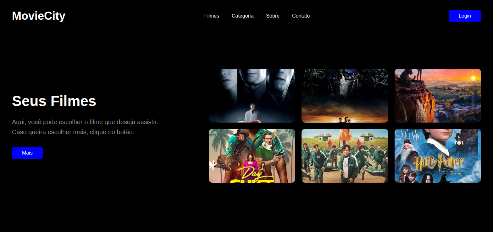
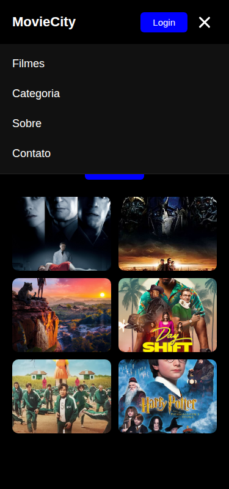

# MovieCity | Landing Page

Uma landing page responsiva para um serviço de streaming fictício, desenvolvida com **React + Vite** e **CSS puro**. O projeto foi criado para praticar componentização, organização de pastas, carregamento de imagens e responsividade.


## Prévia

| Desktop | Mobile | Mobile com o menu aberto |
|---|---|---|
|  |  |  |

## Sobre o projeto

A página apresenta a marca **MovieCity**, um menu de navegação com as opções Filmes, Categoria, Sobre e Contato, além do botão **Login**.

A área principal combina a chamada “Seus Filmes” e o botão **Mais** com uma grade de seis filmes: Afterlife, Transformers, Mowgli, Shift, Round 6 e Harry Potter.

Em telas menores, as colunas são empilhadas, os filmes passam a ser exibidos em duas colunas e a navegação é substituída por um menu hambúrguer que abre e fecha.

## Tecnologias

- React 19
- Vite 8
- JavaScript (ESM)
- CSS puro: media queries, Flexbox e Grid
- oxlint

## Requisitos

- Node.js 20.19+ ou 22.12+
- npm

## Instalação e execução

Instale as dependências e inicie o servidor de desenvolvimento:

```bash
npm install
npm run dev
```

Depois, acesse http://localhost:5173.

| Comando | O que faz |
|---|---|
| `npm run dev` | Inicia o servidor de desenvolvimento com HMR |
| `npm run build` | Gera o build de produção em `dist/` |
| `npm run preview` | Pré-visualiza o build de produção |
| `npm run lint` | Executa a análise estática do código |

## Organização dos arquivos

```text
01_landinpage/
├── public/
│   └── favicon.svg
├── src/
│   ├── assets/            # imagens dos pôsteres
│   ├── components/
│   │   ├── Header.jsx     # cabeçalho e menu hambúrguer
│   │   ├── Main.jsx       # chamada principal e grade de filmes
│   │   └── Home.jsx       # container da página
│   ├── App.jsx            # renderiza <Home />
│   ├── index.css          # estilos globais e responsividade
│   └── main.jsx           # ponto de entrada do React
├── index.html
├── package.json
└── vite.config.js
```

Fluxo de renderização: `index.html → main.jsx → App.jsx → Home.jsx → Header.jsx + Main.jsx`.

## Layout responsivo

| Breakpoint | Dispositivo | Alterações |
|---|---|---|
| `max-width: 1100px` | Tablets em paisagem | Espaçamentos e tipografia menores |
| `max-width: 900px` | Tablets em retrato e celulares grandes | Colunas empilhadas, texto centralizado e menu hambúrguer |
| `max-width: 600px` | Celulares | Grade de filmes com duas colunas |
| `max-width: 380px` | Celulares pequenos | Ajustes de fonte e proporção dos cards |

O layout foi testado nas larguras de 1568, 1024, 768, 600 e 375 px, sem barra de rolagem horizontal.

## Verificações realizadas

- [x] `npm run dev` e `npm run build` executam sem erros
- [x] Visual conferido com a imagem do resultado esperado
- [x] Responsividade verificada nas larguras listadas acima
- [x] Menu hambúrguer abre e fecha, e também fecha ao selecionar um link

## Próximas melhorias

- Transformar os cards em botões acessíveis
- Adicionar título e nota para cada filme
- Buscar filmes em uma API, como a TMDB, e renderizá-los com `.map()`